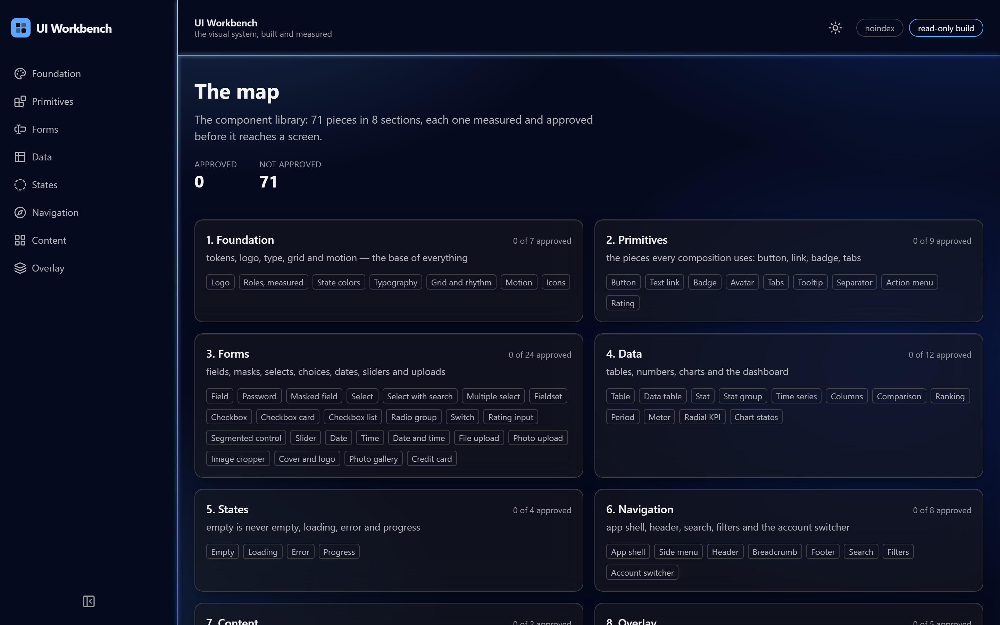
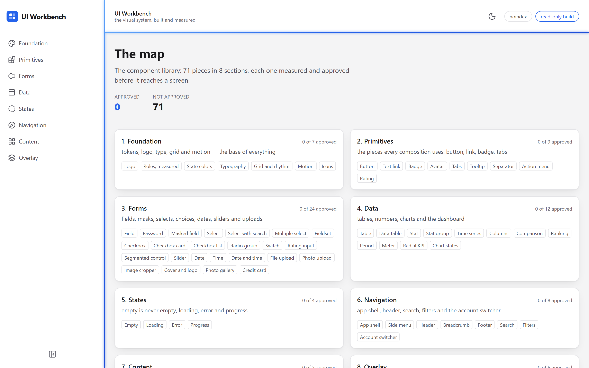
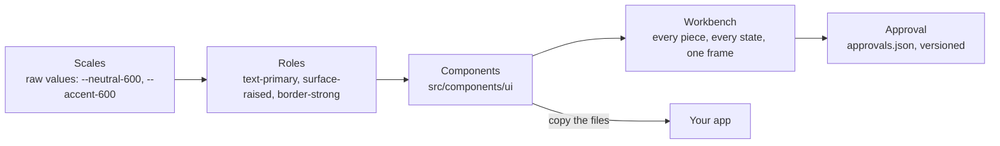

<div align="center">

# UI Workbench

**A brand-neutral React component library, and the workbench where every piece is reviewed, measured and approved before it reaches a screen.**

[](https://github.com/rodriguezMont/UI-Workbench/actions/workflows/ci.yml)
[](LICENSE)


**71 pieces · 8 sections · light and dark · WCAG 2.2 AA, measured by tests**

**English** · [Português](README.pt-BR.md)

</div>

<p align="center">
  
  
</p>

---

## What it is

Two things that live together:

- **A component library** — buttons, fields, selects, date pickers, file and
  photo uploads, tables, charts, navigation, dialogs, sheets and toasts. Written
  in React and TypeScript, styled only through design tokens, with no brand
  baked in.
- **A workbench** — a small app that shows every piece in the same frame: its
  real states side by side (empty, filled, error, disabled, loading…), a short
  explanation of when to use it, and an **approval seal**. A piece is only
  ready when someone has looked at it at real sizes and approved it.

The library is **distributed by copy**, the way shadcn/ui is: an app takes
the files it needs into its own source tree and owns them from then on. There
is no npm package to install or keep up with.

## Why I built it

Every product I build ends up needing the same foundation: components that
look right, read right in light and dark, hold up on a phone, and can be
trusted by the next person who uses them. I had already built that foundation
once, piece by piece and against real screens, inside a product of my own.

UI Workbench is that work taken out of the product and made reusable:

- **Stripped of the brand.** Neutral grays, one accent, the system font and a
  provisional logo. Any company can put its own identity on top without
  touching a single component.
- **Kept with the rules that made it good.** Contrast, touch targets, keyboard
  use and layout are checked by tests and by rulers in a real browser, not
  left to good intentions.
- **Reviewed in the open.** The workbench is where a team — designers,
  developers, product — looks at the same piece in the same frame and decides
  whether it is ready.

The point is a **starting design system you can adopt in an afternoon**:
download it, rebrand the tokens, review the pieces in the workbench, and copy
what your app needs.

## Why it matters

| The usual problem | What this project does instead |
| --- | --- |
| The design file and the code drift apart | The reference **is** the running code: the workbench renders the real components |
| Accessibility is promised, then forgotten | Every color pair is resolved in both themes and checked against WCAG 2.2 AA in `npm test`; the rulers check 44px touch targets and no sideways scroll at 375, 768, 1280 and 1920 |
| Rebranding means rewriting components | Components read only semantic roles (`text-primary`, `surface-raised`); a rebrand edits the scales in one file |
| "Done" means "it compiled" | Each piece carries an approval, recorded in a versioned ledger: a mass approval would show up in review |
| A library locks you into its versions | Copy distribution: you own the code, so you can change it |

## How it works



1. **Tokens in two layers.** Scales hold raw values; roles say what a surface
   or a text is for. Components only ever see roles, and Tailwind's default
   palette is removed, so `bg-blue-500` cannot slip in.
2. **Light and dark in one place.** Each role holds both values through
   `light-dark()`. The page follows the system; `data-theme` forces a scheme
   on any subtree. No `dark:` variants anywhere.
3. **Every piece on the map.** A registry lists every section and piece; tests
   fail if a component has no entry or a built piece is missing from its page.
4. **Approval is a click on the seal** — on the local dev server only. It
   writes one line per piece to `src/workbench/approvals.json`, which is
   committed with the work. The published workbench is read-only.
5. **Guardrails on every change.** Type-check, lint, the full test suite and
   the build run in CI on every pull request; the layout and touch rulers run in a real browser.

## What's inside

| Section | Pieces | Examples |
| --- | ---: | --- |
| Foundation | 7 | logo, roles and their measured contrast, state colors, typography, grid and rhythm, motion, icons |
| Primitives | 9 | button, text link, badge, avatar, tabs, tooltip, separator, action menu, rating |
| Forms | 24 | field, password, masked fields, phone, selects with search and multiple choice, checkboxes, radios, switch, slider, date and time pickers, file and photo upload, image cropper, card form |
| Data | 12 | table, data table, stats, time series, columns, comparison, ranking, meter, radial KPI, chart states |
| States | 4 | empty, loading (skeletons and spinners), error, progress |
| Navigation | 8 | app shell, side menu, header, breadcrumb, footer, search, filters, account switcher |
| Content | 2 | carousel, map placeholder |
| Overlay | 5 | overlay, sheet, dialog and alert dialog, full-screen panel, toast |

The charts are hand-drawn SVG and HTML, with no chart library, and each one
offers its numbers as a table.

## Try it

**Live workbench:** _link coming soon_

Or run it locally:

```sh
git clone https://github.com/rodriguezMont/UI-Workbench.git
cd UI-Workbench
npm install
cp .blocklist.example .blocklist
npm run dev
```

Open the address Vite prints, switch between light and dark in the header, and
browse the sections. Approving a piece works here, on the dev server.

## Make it yours

1. **Rebrand the scales** in `src/styles/tokens.css` — the neutral grays and
   the accent. Every component follows; the contrast tests tell you if a new
   color breaks a pair.
2. **Replace the logo** in `src/components/brand/` — the one file a rebrand
   swaps.
3. **Review in the workbench** and approve what is ready.
4. **Copy what you need** into your app: the styles, the components, `lib/`
   and `messages/`. Requires Tailwind CSS v4. No component imports a router —
   links come in through `asChild`.

The step-by-step, with the dependencies each component needs, is in the
[guide](docs/GUIDE.md#using-the-library-in-an-app).

## Built with

React 19 · TypeScript · Tailwind CSS v4 · Vite 7 · Radix UI · Vitest ·
Playwright. Interface copy is en-US, centralized in `src/messages/`.

Built with AI-assisted development (Claude Code), under the same guardrails a
team would use: every change goes through a pull request, CI and the tests
above.

## Learn more

- **[Guide](docs/GUIDE.md)** — scripts, project layout, the workbench and its
  approval flow, design tokens, copying the library into an app, the
  blocklist guard.
- **[Progress](docs/PROGRESS.md)** — what has been delivered, pull request by
  pull request, and what comes next (the brand guide).

## License

[MIT](LICENSE) © Silvio Monteiro
