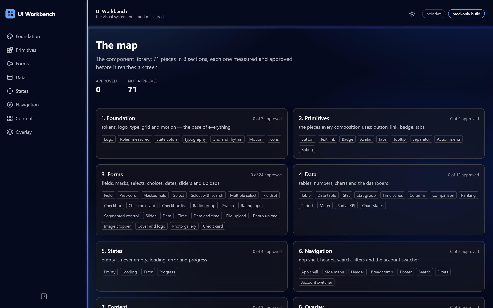
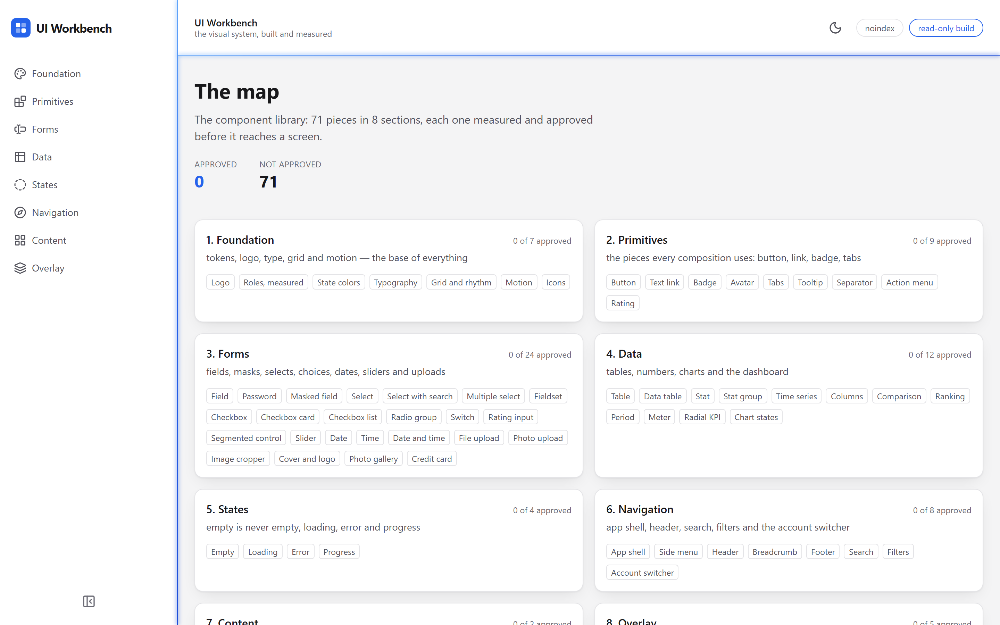
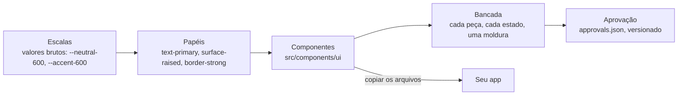

<div align="center">

# UI Workbench

**Uma biblioteca de componentes React neutra de marca, e a bancada onde cada peça é revisada, medida e aprovada antes de chegar a uma tela.**

[](https://github.com/rodriguezMont/UI-Workbench/actions/workflows/ci.yml)
[](LICENSE)


**71 peças · 8 seções · claro e escuro · WCAG 2.2 AA, medido por testes**

[English](README.md) · **Português**

</div>

<p align="center">
  
  
</p>

---

## O que é

Duas coisas que vivem juntas:

- **Uma biblioteca de componentes** — botões, campos, seletores, seletores de
  data, envio de arquivos e fotos, tabelas, gráficos, navegação, diálogos,
  painéis e avisos. Escrita em React e TypeScript, estilizada só por design
  tokens, sem nenhuma marca embutida.
- **Uma bancada** — um pequeno app que mostra cada peça na mesma moldura: seus
  estados reais lado a lado (vazio, preenchido, erro, desabilitado,
  carregando…), uma explicação curta de quando usá-la e um **selo de
  aprovação**. Uma peça só está pronta quando alguém a olhou em tamanho real e
  a aprovou.

A biblioteca é **distribuída por cópia**, como o shadcn/ui: um app leva os
arquivos de que precisa para o próprio código e passa a ser dono deles. Não há
pacote npm para instalar nem para acompanhar.

## Por que eu fiz

Todo produto que eu construo acaba precisando da mesma base: componentes com
boa aparência, legíveis no claro e no escuro, que funcionam no celular e em que
a próxima pessoa a usá-los possa confiar. Eu já tinha construído essa base uma
vez, peça por peça e contra telas reais, dentro de um produto meu.

O UI Workbench é esse trabalho tirado do produto e tornado reutilizável:

- **Sem a marca.** Cinzas neutros, uma cor de destaque, a fonte do sistema e um
  logo provisório. Qualquer empresa pode colocar a própria identidade por cima
  sem mexer em um único componente.
- **Com as regras que o fizeram bom.** Contraste, áreas de toque, uso pelo
  teclado e layout são verificados por testes e por réguas num navegador real,
  não deixados às boas intenções.
- **Revisado às claras.** A bancada é onde um time — design, desenvolvimento,
  produto — olha a mesma peça na mesma moldura e decide se ela está pronta.

O objetivo é um **design system inicial que dá para adotar numa tarde**:
baixar, aplicar a sua marca nos tokens, revisar as peças na bancada e copiar o
que o seu app precisa.

## Por que isso importa

| O problema de sempre | O que este projeto faz no lugar |
| --- | --- |
| O arquivo de design e o código se distanciam | A referência **é** o código rodando: a bancada mostra os componentes reais |
| A acessibilidade é prometida e depois esquecida | Cada par de cores é resolvido nos dois temas e verificado contra a WCAG 2.2 AA no `npm test`; as réguas conferem áreas de toque de 44px e nenhuma rolagem lateral em 375, 768, 1280 e 1920 |
| Trocar a marca significa reescrever componentes | Os componentes leem só papéis semânticos (`text-primary`, `surface-raised`); trocar a marca é editar as escalas em um arquivo |
| "Pronto" significa "compilou" | Cada peça tem uma aprovação, registrada num arquivo versionado: uma aprovação em massa apareceria na revisão |
| Uma biblioteca prende você às versões dela | Distribuição por cópia: o código é seu, então você pode mudá-lo |

## Como funciona



1. **Tokens em duas camadas.** As escalas guardam os valores brutos; os papéis
   dizem para que serve uma superfície ou um texto. Os componentes só enxergam
   papéis, e a paleta padrão do Tailwind foi removida, então um `bg-blue-500`
   não tem como escapar.
2. **Claro e escuro no mesmo lugar.** Cada papel guarda os dois valores com
   `light-dark()`. A página segue o sistema; `data-theme` força um tema em
   qualquer trecho. Nenhuma variante `dark:` em lugar nenhum.
3. **Toda peça no mapa.** Um registro lista todas as seções e peças; os testes
   falham se um componente não tiver entrada ou se uma peça construída faltar
   na sua página.
4. **Aprovar é um clique no selo.** No servidor de desenvolvimento local, ele
   grava uma linha por peça em `src/workbench/approvals.json`, que é commitado
   junto com o trabalho. Na bancada publicada, cada visitante revisa a própria
   cópia, salva só no navegador dele, e volta às aprovações do projeto com um
   clique.
5. **Proteções em toda mudança.** Verificação de tipos, lint, toda a suíte de
   testes e o build rodam no CI a cada pull request; as réguas de layout e de
   toque rodam num navegador real.

## O que tem dentro

| Seção | Peças | Exemplos |
| --- | ---: | --- |
| Fundação | 7 | logo, papéis e seu contraste medido, cores de estado, tipografia, grade e ritmo, movimento, ícones |
| Primitivos | 9 | botão, link de texto, badge, avatar, abas, tooltip, separador, menu de ações, avaliação |
| Formulários | 24 | campo, senha, campos com máscara, telefone, seletores com busca e múltipla escolha, caixas de marcar, opções, interruptor, slider, seletores de data e hora, envio de arquivo e foto, recorte de imagem, formulário de cartão |
| Dados | 12 | tabela, tabela de dados, números em destaque, série no tempo, colunas, comparação, ranking, medidor, KPI radial, estados de gráfico |
| Estados | 4 | vazio, carregando (skeletons e spinners), erro, progresso |
| Navegação | 8 | estrutura do app, menu lateral, cabeçalho, breadcrumb, rodapé, busca, filtros, troca de conta |
| Conteúdo | 2 | carrossel, espaço de mapa |
| Sobreposição | 5 | camada sobreposta, painel, diálogo e diálogo de alerta, painel em tela cheia, aviso |

Os gráficos são desenhados à mão em SVG e HTML, sem biblioteca de gráficos, e
cada um oferece seus números em forma de tabela.

A interface da bancada e da biblioteca é em inglês (en-US).

## Experimente

**Bancada publicada:** **[glad-bisque-gnu-01.hostingersite.com](https://glad-bisque-gnu-01.hostingersite.com/)** — aprove e desfaça à vontade: a sua revisão fica no seu navegador, e as aprovações do projeto não mudam.

Ou rode localmente:

```sh
git clone https://github.com/rodriguezMont/UI-Workbench.git
cd UI-Workbench
npm install
npm run dev
```

Abra o endereço que o Vite mostrar, alterne entre claro e escuro no cabeçalho
e navegue pelas seções. Aprovar uma peça funciona aqui, no servidor de
desenvolvimento.

## Deixe com a sua cara

Este template é neutro de propósito: faça um fork ou copie para o seu projeto
e aplique a sua marca lá. **Usa um assistente de código com IA?** Aponte para
o [AGENTS.md](AGENTS.md) (o Claude Code o lê pelo `CLAUDE.md`): ele explica
o projeto, pede a sua marca — nome, logo, cores, fonte, formato regional — e
a aplica seguindo o [docs/BRAND.md](docs/BRAND.md) (ambos em inglês).

1. **Troque as escalas** em `src/styles/tokens.css` — os cinzas neutros e a cor
   de destaque. Todos os componentes acompanham; os testes de contraste avisam
   se uma cor nova quebrar algum par.
2. **Substitua o logo** em `src/components/brand/` — o único arquivo que uma
   troca de marca substitui.
3. **Revise na bancada** e aprove o que estiver pronto.
4. **Copie o que precisar** para o seu app: os estilos, os componentes, `lib/`
   e `messages/`. Requer Tailwind CSS v4. Nenhum componente importa um router —
   os links entram por `asChild`.

**Para commitar na sua cópia:** o `npm install` liga um hook do git que
impede termos escolhidos de entrarem num commit, e ele se recusa a passar sem
uma lista. Copie o `.blocklist.example` para `.blocklist` e coloque os seus
termos (ou mantenha os de exemplo). Os detalhes estão no
[guia](docs/GUIDE.md#the-blocklist-guard) (em inglês).

A troca de marca, passo a passo, está no [docs/BRAND.md](docs/BRAND.md); como
copiar para um app, com as dependências de cada componente, está no
[guia](docs/GUIDE.md#using-the-library-in-an-app) (ambos em inglês).

## Feito com

React 19 · TypeScript · Tailwind CSS v4 · Vite 7 · Radix UI · Vitest ·
Playwright. Os textos da interface são em en-US, centralizados em
`src/messages/`.

Feito com desenvolvimento assistido por IA (Claude Code), sob as mesmas
proteções que um time usaria: toda mudança passa por pull request, CI e os
testes acima.

## Saiba mais

- **[AGENTS.md](AGENTS.md)** (em inglês) — o briefing para assistentes de
  código com IA: o que é o projeto, o que perguntar antes de trocar a marca, as
  regras que precisam valer.
- **[Troca de marca](docs/BRAND.md)** (em inglês) — todo lugar onde a marca
  mora: cores, logo, favicon, nome, fonte, formas, formato regional, e como
  conferir.
- **[Guia](docs/GUIDE.md)** (em inglês) — scripts, estrutura do projeto, a
  bancada e o fluxo de aprovação, design tokens, como copiar a biblioteca para
  um app, o guard da blocklist.
- **[Deploy](docs/DEPLOY.md)** (em inglês) — como a bancada é publicada no
  Node.js gerenciado da Hostinger.
- **[Progresso](docs/PROGRESS.md)** (em inglês) — o que foi entregue, pull
  request por pull request, e o que vem a seguir.

## Licença

[MIT](LICENSE) © Silvio Monteiro
